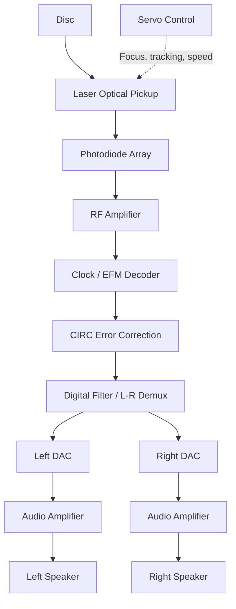

# Practical 05 — Study of CD Player

## Write-Up
**Aim:** Study the theory, block diagram, and blocks of a CD player.  
**Apparatus:** CD player and block diagram.

## Theory
A CD player reproduces digitally recorded audio from a compact disc. A laser reads the spiral track's microscopic pits and lands without physical contact. Reflected light is converted to electrical data, decoded and error-corrected, then converted to left/right analog audio and amplified. CDs use 16-bit, 44.1 kHz audio, EFM encoding and CIRC error correction. Small reading errors can be corrected. Disc speed varies to maintain constant linear velocity.

## Block Diagram

## Function of Blocks
- **Optical pickup/objective lens:** Focuses laser and routes reflected light to detector.
- **Laser diode:** Produces the infrared read beam (about 780 nm).
- **Monitor diode/APC:** Monitors and stabilizes laser power.
- **Photodiode array:** Converts reflected light to data and focus/tracking error signals.
- **RF amplifier:** Amplifies weak pickup signal.
- **Clock/sync circuits:** Recover timing and synchronization.
- **EFM demodulator:** Decodes recorded data and separates control/subcode data.
- **CIRC correction:** Detects/corrects data errors; uncorrectable errors may be muted.
- **Interpolation/muting:** Estimates short missing samples or suppresses clicks.
- **Digital filter/demultiplexer:** Filters data and separates stereo channels.
- **DAC, amplifier, speakers:** Convert digital audio to analog, amplify, and reproduce sound.
- **Servo/control:** Maintains focus, tracking, disc speed, and display/control operation.

## Working
Laser reads the disc; the detector produces RF data. Amplification, clock recovery, EFM decoding and error correction recover digital audio. Digital filtering and channel separation feed DACs, then audio amplifiers and speakers. Servo circuits continuously adjust focus, tracking, and disc rotation.

## Advantages
High sound quality; non-contact reading; correction of minor errors; track/repeat/display functions; compact media.

## Disadvantages
Deep scratches can cause skipping; optical/servo mechanisms are complex; laser can age; vibration affects playback.

## Conclusion
CD playback relies on optical sensing, decoding, error correction, servo control and digital-to-analog conversion.
