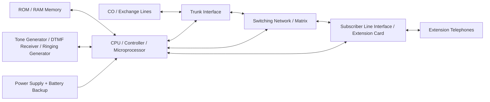

# Practical 08 — Study of EPABX System

## Write-Up

### Aim
To study the EPABX system.
- To study the basic theory of an EPABX system.
- To study its block diagram and the function of each block.

### Apparatus
EPABX system (trainer kit/model), telephone instruments.

### Theory
EPABX stands for **Electronic Private Automatic Branch Exchange**. It is a private telephone exchange installed within an organisation such as an office, factory, hotel, hospital, or railway station. It connects internal telephones (extensions) to one another and to the public telephone network (PSTN) through a limited number of external **CO (Central Office) lines**, also called trunk lines. Sharing a few outside lines among many extensions reduces telephone connection costs.

- **Private:** The exchange belongs to the organisation.
- **Automatic:** Calls are connected automatically without a human operator.
- **Electronic:** Switching is performed by electronic circuits controlled by a microprocessor (stored-program control), rather than electromechanical relays.

### Block Diagram

### Working of Each Block

1. **CO / Trunk Interface:** Connects the EPABX to PSTN lines. Detects incoming ringing, seizes a line for outgoing calls, and carries speech in both directions.
2. **Subscriber Line Interface (Extension Card):** Connects extension telephones; supplies DC talk battery and ringing, detects on-hook/off-hook states, and receives dialled digits.
3. **Switching Network (Matrix):** Establishes a speech path between two extensions or between an extension and a CO line for the call. In electronic EPABX, it may use a digital PCM time-slot switching matrix.
4. **CPU / Controller:** The main controller. Scans lines, interprets dialled digits, selects call routing, and controls the switching network and other cards.
5. **ROM / RAM Memory:** ROM stores the operating program. RAM stores changeable information such as call data, extension numbers, class of service, and user-programmed features.
6. **Tone Generator, DTMF Receiver and Ringing Generator:** Generates dial, busy, and ring-back tones; decodes DTMF digits; and supplies ringing voltage (about 75 V AC) to the called telephone.
7. **Power Supply and Battery Backup:** Supplies regulated DC voltages to the cards and keeps the system operating during mains failure using battery backup.

### Basic Call Procedure

1. The user lifts the handset (off-hook); the CPU detects the condition and provides a dial tone.
2. The user dials the required digits. For an internal call, the CPU identifies the extension; if it is free, ringing is sent and ring-back tone is provided to the caller.
3. For an outside call, the user dials an access code (for example, **9**). The CPU connects a free CO line and sends the number to PSTN.
4. When the called party answers, the switching network establishes the speech path.
5. When either party replaces the handset (on-hook), the call is disconnected and the path is released.

### Features of EPABX
- Intercom calls between extensions without an outside line.
- Call transfer, call forwarding, call waiting, call hold, and conference calling.
- Direct Inward Dialling (DID), Least Cost Routing, and speed dialling.
- Class of service (e.g., restricting STD/ISD calls from selected extensions) and call detail recording for billing.
- Automatic attendant, voice mail, and music on hold.

### Advantages
- A few CO lines can serve many extensions, reducing cost.
- Calls between extensions are free of charge.
- Features can be added or changed through programming.
- Compact size, low maintenance, and easier expansion than electromechanical exchanges.

### Applications
Used in offices, factories, hotels, hospitals, banks, colleges, and railway stations for internal communication and access to PSTN.

### Exam-Oriented Quick Revision
- **EPABX full form:** Electronic Private Automatic Branch Exchange.
- **CO line:** Central Office line; external line connecting the organisation to PSTN.
- **Extension:** Internal telephone connected to EPABX.
- **CPU role:** Controls line scanning, digit interpretation, routing, and switching.
- **Switching matrix role:** Connects the caller and called party's speech paths.
- **DTMF:** Dual-Tone Multi-Frequency; keypad dial digits are decoded by the DTMF receiver.
- **On-hook / Off-hook:** Handset placed down / lifted.
- **Outside-call access code:** Often 9 (example; may vary by system).
- **Ringing voltage:** About 75 V AC, as specified in the supplied practical.
- **Key advantage:** Many extensions share a limited number of external CO lines.

### Conclusion
The EPABX system was studied, including its block diagram, function of each block, basic call procedure, features, advantages, and applications.
