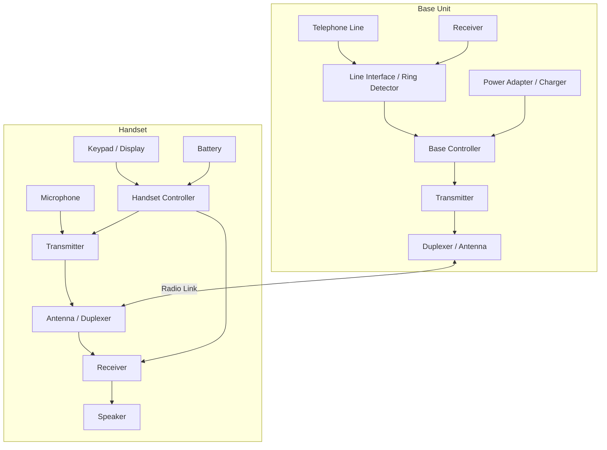

# Practical 10 — Study of Cordless Telephone

## Write-Up
**Aim:** Study cordless telephone theory, block diagram and block functions.  
**Apparatus:** Cordless phone base, handset and block diagram.

## Theory
A cordless phone uses a two-way radio link between the handset and base instead of a wire. The base connects to the telephone network and power. Radio coverage depends on the model and environment. Base and handset each have transmitter and receiver circuits for duplex speech. Older analog systems used bands near 46/49 MHz; newer examples include 900 MHz, 2.4/5.8 GHz and DECT near 1.9 GHz.

## Block Diagram

## Base Unit Blocks
Line interface connects to phone line, detects ring and manages line state; controller handles call signaling and channel selection; transmitter sends base audio; receiver returns handset audio; duplexer/antenna handles radio; adapter powers and charges.

## Handset Blocks
Antenna/duplexer; receiver/demodulator; transmitter/modulator; microphone and speaker; keypad/display; handset controller; rechargeable battery.

## Working
- **Incoming:** Base detects ringing and radios handset. Talk sends off-hook command and connects the line.
- **Outgoing:** Handset sends digits; base seizes line and dials.
- **Conversation:** Both directions use duplex radio channels.
- **Security:** Digital code/registration helps prevent unauthorized access.

## Advantages
Mobility, no handset cord, compatible multi-handset/intercom features, and digital features such as caller ID/phonebook.

## Disadvantages
Limited radio range, walls weaken signal, base may fail without power, handset needs charging.

## Conclusion
Cordless telephones replace the handset cord with a radio link while the base remains connected to the phone network.
